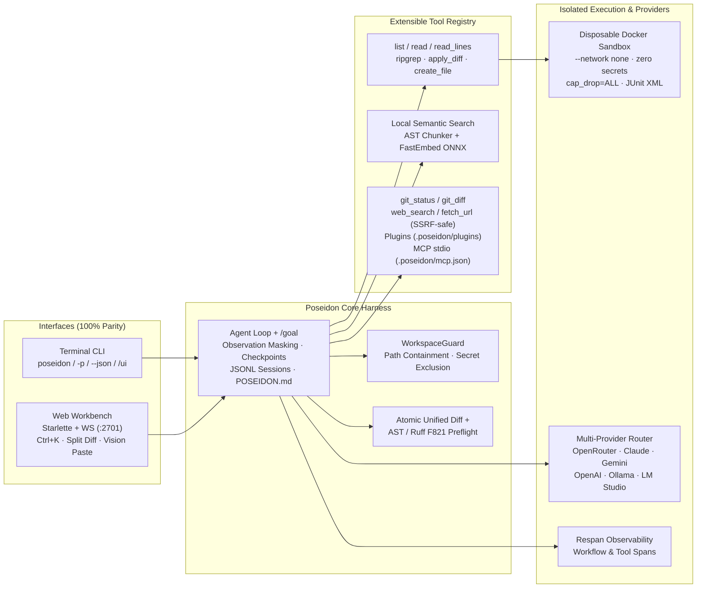

# Poseidon-CLI

> **A containerized, multi-provider Python coding agent harness** with an interactive Terminal CLI (`poseidon`), an Abyssal-Ocean Web Workbench (`http://localhost:2701`), native tool calling, atomic unified diffs, AST + Ruff preflight validation, local ONNX semantic code search, isolated `--network none` Docker test verification, autonomous `/goal` execution, plugins, MCP, Local AI (Ollama / LM Studio), and multimodal vision/screenshot support.

---

## Architecture



---

## Key Capabilities

- **Instant Launch Everywhere:** Global `poseidon` and `poseidon ui -d` shims (`scripts/install.ps1`) mount your current directory cleanly into Docker — zero local Python pollution.
- **Terminal CLI & Abyssal-Ocean Web UI (100% Parity):**
  - Live WebSocket streaming on **`http://localhost:2701`** (multi-port `--port 2702`, detached `-d` with browser auto-open, reload-safe 8s auto-shutdown on tab close, or 1-click `⏻ Stop`).
  - Launch Web UI straight from inside an active terminal session via `/ui` (seamlessly resuming your current conversation).
  - **`Ctrl+K`** fuzzy command/file palette, **`@file`** & **`@image.png`** mentions + fuzzy `@` picker, **Split / Unified Diff** approval cards, **Prompt History (`↑`/`↓`)**, **Clipboard Screenshot Paste (`Ctrl+V`)** for vision models, and **Centered 5-Tab Settings Modal**.
- **6 AI Providers (Cloud + Local AI):**
  - **OpenRouter** (default free model `nvidia/nemotron-3.5-super-vl:free` + live catalog browser in Settings)
  - **Local AI (Zero API Key):** **Ollama** (`ollama:<model>`) and **LM Studio** (`lmstudio:<model>`) with live host auto-discovery (`host.docker.internal`)
  - **Direct Cloud BYOK:** **Anthropic Claude** (`anthropic:<model>`), **Google Gemini** (`gemini:<model>`), **OpenAI GPT** (`openai:<model>`) — keys stored outside the project folder in a `0600` Docker volume (`poseidon_secrets`), never committed to Git or logged.
- **Autonomous `/goal` Engine:** Read-only planning pass → bounded execute-and-verify iterations → strict test-verification completion gate + anti-stuck breaker + live cancellation.
- **Reliability & Context Engineering:**
  - Atomic unified diffs with SHA-256 stale-file checks, read-before-edit enforcement, and surrounding-line mismatch recovery.
  - **Python AST + Ruff `F821–F823` Preflight Guard** blocking syntax errors before disk write and catching missing imports before slow container runs.
  - **Deterministic Observation Masking** (`/compact` + automatic in loop) and **Pre-Edit Workspace Checkpoints** (`/undo`, `/checkpoints`).
  - **Persistent Global & Workspace Custom `/Commands`** (`~/.poseidon_secrets/commands/*.md` & `.poseidon/commands/*.md`).

---

## Quickstart (Docker)

### 1. Configure Environment & Build Images
```powershell
cp .env.example .env
# Add OPENROUTER_API_KEY (and optional RESPAN_API_KEY) to .env — or use local Ollama/LM Studio with zero keys!

docker compose build poseidon
docker compose --profile build-only build poseidon-sandbox
```

### 2. Install Global `poseidon` Command (Windows)
```powershell
.\scripts\install.ps1
```
Now run Poseidon from **any** project directory:

```powershell
cd path\to\your\project

# Interactive terminal coding agent
poseidon
poseidon --plan                 # Read-only Plan Mode (write tools physically omitted)
poseidon --continue             # Resume latest JSONL session

# Detached Web Workbench (auto-opens http://localhost:2701, keeps terminal free, auto-stops on tab close)
poseidon ui -d
poseidon ui -d --port 2702      # Run a second workspace simultaneously
poseidon ui status              # List running Web UI instances
poseidon ui stop --all          # Stop all Web UI instances

# 1-second environment & provider health check
poseidon doctor

# Headless pipe / CI mode
git diff | poseidon -p "Review this diff for bugs" --plan
poseidon -p "Summarize @analytics.py" --model ollama:qwen3:8b --plan --json
```

---

## Empirical Benchmarks

All benchmarks were executed live inside Docker against real workspaces and isolated `--network none` test sandboxes:

### Local Semantic Search vs. Lexical Grep (Milestone 6 — `BAAI/bge-small-en-v1.5` ONNX)
| Retrieval Engine | Questions Answered (Top-3) | Total Lookup Time (4 queries) | Avg Query Latency |
| --- | :---: | :---: | :---: |
| Ripgrep (`rg`) | 2 / 4 (50%) | 88.24 ms | 22.06 ms |
| **FastEmbed Local Index** | **4 / 4 (100%)** | **9.20 ms** | **2.30 ms** |

### Context Compaction — Deterministic Observation Masking (Milestone 7)
- Masked stale bulky tool outputs while preserving recent turns verbatim: **50.6% context reduction** (`4,680 → 2,312 chars`, ~592 tokens saved) in a single turn with zero LLM summarization cost.

### AST + Ruff Preflight Guard — Baseline (`v1`) vs. Preflight (`v2`) (Optional Challenge)
Evaluated on `nvidia/nemotron-3.5-super-vl:free` (`--max-calls 10`) across both the original `--exclude` task and a **held-out** `--min-amount` task with hidden acceptance tests:

| Variant | Task 1 (`--exclude`) Acceptance | Task 1 Elapsed | Task 2 (Held-out `--min-amount`) Visible / Acceptance | Task 2 Elapsed |
| --- | :---: | :---: | :---: | :---: |
| Baseline (`v1`) | FAIL (0/1) | 32.67s | 2/6 · FAIL (0/1) | 41.09s |
| **+ AST & Ruff Preflight (`v2`)** | **PASS (1/1)** | **21.33s (-35%)** | **6/6 · PASS (1/1)** | **29.59s (-28%)** |

---

## Slash Commands (Shared Between Terminal & Web UI)

| Command | Purpose |
| --- | --- |
| `/goal [--steps N] <objective>` | Autonomous Plan → Execute → Verify loop with completion & anti-stuck gates |
| `/plan` | Toggle read-only Plan Mode (physically omits `apply_diff` & `create_file`) |
| `/ui [port \| status \| stop]` | Launch or stop the Web UI from inside the terminal (resuming active chat) |
| `/doctor` | Check Docker daemon, sandbox image, `rg`, `git`, API keys, Ollama/LM Studio, MCP |
| `/providers` · `/local` · `/key` | Inspect cloud/local providers, detect Ollama/LM Studio models, save/clear keys |
| `/model [add\|remove\|<id>]` | Switch models mid-chat or manage custom OpenRouter / local / BYOK models |
| `/mcp [add\|remove]` · `/tools` | Manage `.poseidon/mcp.json` stdio servers & inspect Built-in/Plugin/MCP tools |
| `/cmd [list\|add\|remove]` | Create persistent Global or Workspace custom `/command` prompt templates |
| `/test` · `/undo` · `/checkpoints` | Run isolated Docker `pytest` or roll back pre-edit workspace snapshots |
| `/compact` · `/cost` | Run Observation Masking or view cumulative session tokens & USD spend |
| `/search <q>` · `/grep <q>` · `/web` | Local semantic search, ripgrep lexical search, or toggle web search/fetch tools |
| `/save` · `/resume` · `/sessions` · `/clear` | Persist, browse, resume, or clear JSONL transcripts |
| `/memory` · `/init` · `/settings` · `/exit` | Inspect/scaffold `POSEIDON.md`, view settings, or save & shut down cleanly |

---

## Security & Isolation

- **Workspace Containment (`WorkspaceGuard`):** Blocks absolute paths, `..` traversal, and secret patterns (`.env*`, `*.pem`, `*.key`, `*credentials*`, `id_rsa*`) across every tool, file viewer endpoint, and `@file` mention.
- **Disposable Test Sandbox:** Untrusted project code runs in `poseidon-sandbox:dev` with `--network none`, `cap_drop=["ALL"]`, `no-new-privileges:true`, non-root user, 512 MB RAM / 1 CPU / 64 PIDs limits, hard timeout, and **zero secrets injected**.
- **Out-of-Workspace Credentials:** User-entered API keys live in `/home/poseidon/.poseidon_secrets/keys.json` (`0600`, dedicated Docker volume) and are never returned in plaintext.
- **SSRF Protection:** `fetch_url` resolves hostnames and blocks loopback, private RFC1918, link-local, and metadata IPs before and after redirects.

---

## Development & Verification

```powershell
# Lint with ruff inside Docker
docker compose run --rm --entrypoint ruff poseidon check /app/src /app/tests

# Run the full 72-test suite inside Docker
docker compose run --rm --entrypoint pytest poseidon /app/tests

# Refresh deterministic uv.lock
docker run --rm -v "${PWD}:/work" -w /work --entrypoint uv poseidon-cli:dev lock
```
